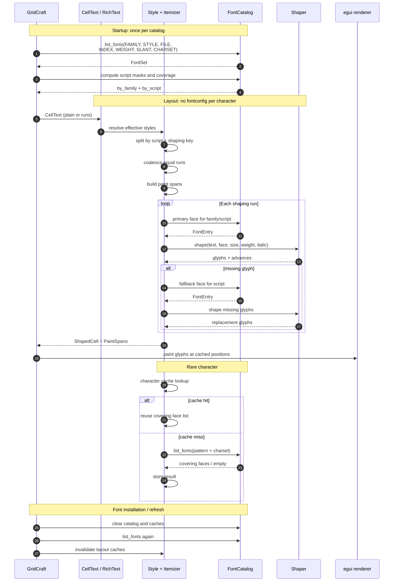
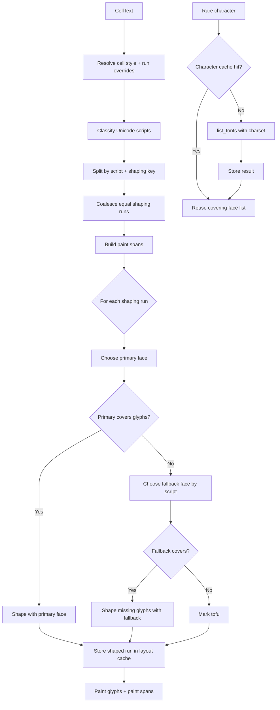

# Font discovery, fallback, and rich text on Linux

Status: design note and implementation map.

- Repository: `storytold/gridcraft`
- Branch: `fix/linux-fontconfig`
- HEAD at the start of this rewrite: `775a14a docs: add Linux font flow design note (#1231)`
- Last updated: 2026-10-23 (merged `origin/main`; fontconfig language rules split)
- Related issue: `#1231`
- Current PR: `#1972` (open; remote branch is older than this local branch)

This document has three layers:

1. **Implemented** — what the code does today.
2. **Target** — the proposed font-catalog, rich-text, and shaping architecture.
3. **Not implemented** — known gaps, API limitations, and migration work.

Do not read a "Target" section as current behavior.

Rich text is part of the target architecture, not an appendix. It changes the
cell data model, the layout pipeline, font binding, editing, and file I/O. The
font-discovery work is a prerequisite, not a replacement for it.

---

## 1. Summary

Current Linux implementation:

- `fc-list` supplies face metadata (file, index, family, style, weight, slant)
  from fontconfig's cache; startup does not open every font file.
- Other platforms read each file with `skrifa`, under a 256 MiB per-file cap,
  and build the same `Face` catalog.
- The resulting `Face` catalog is cached in a process-wide `OnceLock`.
- `fc-match` resolves role families and script families.
- Its index is split into face + named instance; the instance is applied through
  `FontTweak::coords` so variable fonts keep the weight/slant fontconfig matched.
- `fc-match` results are cached in a thread-local `HashMap`.
- Selected workbook fonts are bound into egui lazily; binding still reads the
  whole font file.
- Font roles are published to `cell_family()` only after egui has activated the
  new font set. This avoids a frame that names a family egui does not have yet.

Target implementation:

- Fontconfig is called once at startup to build an in-memory `FontCatalog`.
- The catalog records, per face, which Unicode scripts it covers.
- Cell text can be plain or rich: a list of text runs with optional character
  styles.
- Layout resolves each run's style, itemizes by script and shaping key, shapes
  contiguous runs, and paints color/underline spans separately.
- egui performs per-glyph fallback inside each run.
- Rare characters are looked up by character, cached, and then reused.
- No per-frame fontconfig calls and no per-character `font_match`.

Main unresolved issues:

- First use of a large, previously unbound family can still freeze the UI for
  roughly 1–2 seconds because egui rebuilds its font atlas and glyph cache. That
  is separate from font discovery; see §8.
- Full rich text requires separating shaping attributes from paint attributes.
  `LayoutJob`/`LayoutSection` currently couple them.
- `fontconfig` 0.11 does not expose direct charset introspection; coverage sets
  or upstream API additions are required.

---

## 2. Goals, non-goals, and terminology

### 2.1 Goals

GridCraft must:

- show every installed font in the font picker;
- render workbook text in the chosen font;
- render CJK, Thai, Hebrew, symbols, and emoji without tofu;
- preserve per-character formatting in cell text;
- work on native Linux, Flatpak, macOS, Windows, and wasm;
- never panic because a font file is damaged or a family is not bound;
- avoid rescanning the filesystem or spawning fontconfig processes on every
  frame.

### 2.2 Non-goals

This document does not define:

- a bundled CJK font set;
- a new font file format;
- full CSS-style text layout;
- arbitrary per-character OpenType feature editing;
- a replacement for the platform text stack on macOS/Windows.

Fonts remain external assets. GridCraft must not bundle fonts outside the
`storytold/craft-fonts` policy.

### 2.3 Terminology

| Term | Meaning |
|---|---|
| Face | One font face inside a file. A TTC may contain several faces. |
| Family | Typographic family name, e.g. `Noto Sans CJK SC`. |
| Role | GridCraft's internal font slot: `ui`, `ui-bold`, `cell`, `cell-bold`, `cell-italic`, `cell-bold-italic`, `serif`, `mono`. |
| Script | Unicode script class: Latin, Han, Japanese, Korean, Thai, Hebrew, Symbols, Common. |
| Rich text | A cell text value made of runs, where each run may override the cell's character style. |
| Text run | A contiguous byte range with the same effective character style. Adjacent equal runs are merged. |
| Shaping key | The properties that affect glyph selection and positioning: face, size, weight, italic, features, language, script. |
| Paint span | Properties that affect drawing but not shaping: color, underline, background, border. |
| Coverage | Whether a face has glyphs for the sample characters of a script run. |
| `font_match` | Fontconfig best-match operation. It always returns a closest match, even if the font does not cover the requested charset. |
| `list_fonts` | Fontconfig filtered enumeration. With a charset pattern it returns only candidates matching that pattern. |

---

## 3. Current implementation

This section describes HEAD `09b0d1d` plus the documentation commit `775a14a`.
Line numbers refer to that code state.

### 3.1 Startup and scan

Entry point:

- `crates/ui-egui/src/lib.rs:348` `setup_context_for_language()`
- `crates/ui-egui/src/lib.rs:349` `fonts::start_scan()`

`start_scan()` (`crates/ui-egui/src/fonts.rs:347`) starts a named background
thread (`font-scan`) once. The thread calls `catalog()`.

`catalog()` (`crates/ui-egui/src/fonts.rs:336`) is a `OnceLock<Vec<Face>>`.
It blocks only the first caller; the background thread normally does that work.

`scan_installed()` (`crates/ui-egui/src/fonts.rs:322`):

1. On Linux, call `fontconfig_faces()`.
2. If it returns faces, use them.
3. Otherwise fall back to `scan_dirs(system_font_dirs())`.

`fontconfig_faces()` (`fonts.rs:228`) runs:

```text
fc-list -f "%{file}\t%{index}\t%{family[0]}\t%{style[0]}\t%{weight}\t%{slant}\n"
```

with `LC_ALL=C` so family and style are the English names. Each record becomes a
`Face` directly: family, face index, weight mapped from fontconfig's
`FC_WEIGHT_*` constants to the 100–900 scale, italic from `FC_SLANT_ITALIC`
(`100`) and up, and the serif hint from the family name. Paths are kept
byte-exact (a font path need not be valid UTF-8), filtered to existing files
with supported extensions (`ttf`, `otf`, `ttc`, `otc`), and deduplicated by
`(path, index)`. A variable font's default-instance range row (`[80 200]`, empty
style) is not a usable face and is skipped.

This is also why startup no longer opens every font: the list arrives as
metadata from the fontconfig cache. `fc-list` still runs once, on the background
`font-scan` thread.

`scan_dirs()` (`fonts.rs:202`) recursively walks platform font folders,
canonicalizes directories to avoid symlink loops, and calls `scan_file()` for
each candidate.

### 3.2 Metadata-only face scanning (non-Linux)

`scan_file()` (`fonts.rs:184`) enforces `MAX_FONT_FILE` (256 MiB) and then calls
`file_faces()` (`:110`), which uses `skrifa`'s `FileRef`/`FontRef`: `fonts()`
iterates the faces of a plain sfnt or a collection, `localized_strings` reads
the typographic family/subfamily (falling back to the legacy name IDs) in
English or the first available language, and `os2().panose_10()` supplies the
serif flag. Damaged files, unreadable tables, and out-of-range table offsets
yield no faces, not a panic.

Unlike the Linux path, this reads each candidate file once (peak memory is the
largest file, not the sum), because `skrifa` needs the bytes. The 256 MiB cap
bounds that read; it is not a claim that a larger font could not render.

### 3.3 Face catalog and family list

`Face` (`crates/ui-egui/src/fonts.rs:35`) contains:

```rust
pub struct Face {
    pub family: String,
    pub names: Vec<String>,
    pub path: PathBuf,
    pub index: u32,
    pub weight: f32,
    pub italic: bool,
    pub serif: bool,
}
```

`names` keeps every family name the face carries, `family` first, then each
language's typographic and legacy names (`Malgun Gothic`, `맑은 고딕`), so a
workbook that names the font by any of them binds to it (#1898). On Linux the
list comes from `%{family}` in `fc-list`, which also reports aliases; elsewhere
it comes from the `name` table. `serif` is a catalog hint from the OS/2 panose
(or, on Linux, the family name); binding re-reads panose from the loaded bytes.

Style names are converted to weight and italic flags by `style_weight()` and
`style_italic()`.

`families()` (`:507`) builds the font picker list:

- standard `ribbon::FONTS` names first;
- then installed family names, A–Z, case-insensitively deduplicated.

It never blocks: if the scan is not done, it returns only the standard names.

### 3.4 Font roles and `fc-match`

`theme.rs:340 candidates(role)` produces candidate `(path, index)` pairs.

On Linux, fontconfig candidates are added first:

```rust
#[cfg(target_os = "linux")]
v.extend(linux_fontconfig_candidates(role));
```

The remaining hard-coded paths are a fallback for systems where fontconfig is
missing or returns nothing usable.

`linux_fontconfig_candidates()` (`theme.rs:472`) maps roles to patterns:

| Role | Patterns, in order |
|---|---|
| `ui` | Cantarell, Liberation Sans, DejaVu Sans, Noto Sans, sans-serif |
| `ui-bold` | same with `:weight=bold` |
| `cell` | Calibri, Carlito, Arial, Liberation Sans, DejaVu Sans, sans-serif |
| `cell-bold` | same with `:weight=bold` |
| `cell-italic` | same with `:slant=italic` |
| `cell-bold-italic` | same with `:weight=bold:slant=italic` |
| `serif` | Liberation Serif, DejaVu Serif, serif |
| `mono` | Liberation Mono, DejaVu Sans Mono, Noto Sans Mono, monospace |

`fc_match_candidates()` (`theme.rs:499`) calls `fc_match()` for each pattern,
drops duplicate `(path, index)` pairs, and returns the candidates.

`fc_match()` (`theme.rs:780`) first checks the thread-local `FC_MATCH_CACHE`.
On a miss it runs:

```text
fc-match -f "%{file}\n%{index}\n" <pattern>
```

Results, including failures, are cached for the rest of the process. There is no
invalidation: fonts installed while GridCraft is running are picked up only after
restart.

The fontconfig `index` carries two fields: the face index in the low 16 bits and
a **1-based named instance** in the high 16 bits (`0` means the font's default
instance). `try_load()` (`theme.rs:275`) splits them with `fc_index_parts()`,
keeps the low half in `FontData::index` (a face index, as egui expects) and
applies the named instance through `FontTweak::coords` (`apply_named_instance()`),
reading the axis values with `skrifa`. The bytes themselves come from
`font_file()` (`theme.rs:298`), which reads each file once per process, keeps a
parseable copy for `'static`, and feeds `FontData::from_static` — otherwise egui
kept a second copy of every loaded face (about 100 MB on a Mac). Without that, a variable font always
rendered its default instance: fontconfig resolves `Noto Sans:weight=bold` to
named instance 3 (wght 700), whose raw index is `262144`, and Noto Sans CJK's
default instance is Thin (wght 100) — masking the index made bold text and
`serif` CJK text render in the wrong weight.

Do not gate this on fontconfig's `%{variable}`: it returns `False` for both
variable TTFs and named instances inside variable collections on
fontconfig 2.17, so it cannot distinguish a static face from a named instance.

### 3.5 Font definitions and script fallback

`font_definitions_with_bound()` (`theme.rs:551`) builds the egui font set and
returns `(FontDefinitions, Vec<String>)`.

It:

1. starts from egui's defaults;
2. loads the sans script fallback faces with `load_fallback(fonts, han, false)`;
3. decides whether serif faces are needed: `want_serif` is true when a workbook
   family in `used` reads as serif (`family_name_is_serif()`: Times, Georgia,
   Cambria, Garamond, any `*Serif*` that is not a `*Sans*` name). Only then does
   it call `load_fallback(fonts, han, true)`. Noto Serif CJK alone is ~55 MB, so
   a sans-only workbook must not pay for it;
4. for each role (`ui`, `ui-bold`, `cell`, `cell-bold`, `cell-italic`,
   `cell-bold-italic`, `serif`, `mono`):
   - resolves candidates;
   - loads the first parseable face with `try_load()`;
   - inserts it as `sys-{role}`;
   - falls back to `sys-ui` or `sys-cell` for missing bold/italic roles;
   - extends the chain with egui's base proportional/monospace chain and the
     script fallback keys; the `serif` role uses the serif set when `want_serif`,
     every other role uses the sans set;
5. binds installed workbook families with `bind_family()`; each bound role chain
   ends with the fallbacks that match its primary face — `ScriptFallbacks::serif`
   for a serif face, `ScriptFallbacks::sans` otherwise. The keys are explicit
   because at this point `FontFamily::Proportional` may still be egui's bundled
   Latin-only fonts, so a Latin family such as DejaVu Sans would otherwise show
   tofu for CJK (#1231);
6. inserts the cell face before script fallback faces in interface chains;
7. sets `FontFamily::Proportional` to the UI chain;
8. drops unparseable faces with `drop_unparseable_fonts()`.

`font_definitions_with()` (`theme.rs:542`) is the non-deferred wrapper: it calls
`font_definitions_with_bound()` and immediately publishes `set_bound(bound)`.

`font_definitions_with_bound()` is used when egui will activate the new set on
the next pass. Publishing the roles immediately would let `cell_family()` name a
family that the current pass has not installed yet.

`fallback_faces()` (`theme.rs:683`) returns `ScriptFace { key, sans, serif }`
entries in chain order:

| Key | Script | Serif companion |
|---|---|---|
| `sys-cjk-han-zh` / `sys-cjk-han-ja` | Han (SC / JP; order from `HanOrder`) | `sys-cjk-han-zh-serif` / `sys-cjk-han-ja-serif` |
| `sys-cjk-hangul` | Hangul | `sys-cjk-hangul-serif` |
| `sys-thai` | Thai | `sys-thai-serif` |
| `sys-lao` | Lao | `sys-lao-serif` |
| `sys-khmer` | Khmer | `sys-khmer-serif` |
| `sys-hebrew` | Hebrew | `sys-hebrew-serif` |
| `sys-arabic` | Arabic | `sys-arabic-serif` (Naskh) |
| `sys-devanagari` | Devanagari | `sys-devanagari-serif` |
| `sys-myanmar` | Myanmar | — (Padauk has one design) |
| `sys-tibetan` | Tibetan | — (Jomolhari has one design) |
| `sys-yi` | Yi | — (Noto Sans Yi) |
| `sys-symbols` / `sys-symbols-2` | symbols | — |

Each script function asks fontconfig first on Linux (`sans-serif:lang=…` for
the sans list, `serif:lang=…` for the serif list; Arabic's serif companion is
Noto Naskh Arabic), then appends the hard-coded paths in
`LINUX_CJK_FALLBACK_DIRS` (`theme.rs:714`) and the platform-specific paths.

`load_fallback()` (`theme.rs:642`) loads at most one file per key and records
loaded paths **within one call**. Sans and serif are two independent calls, so
the region-merged Sans CJK TTC and the Serif CJK TTC each load once, and a
script whose serif companion is missing simply has no serif key. A serif face
whose script has no serif companion (Myanmar, Tibetan, Yi) keeps the sans key:
the script still renders, only the style is not distinct.

`bind_faces()` (`fonts.rs:501`) selects the column from the panose of the bytes
it just loaded (`face_is_serif()`, `(2, 2..=10)`), not from the catalog hint: on
Linux `Face.serif` comes from the family name because `fc-list` does not expose
panose, so only the loaded OS/2 table can decide. No separate `serif_variant()`
mapping is needed: a serif family never inherits the sans script set.

### 3.6 Binding workbook fonts

`used_fonts()` (`lib.rs:356`) collects the families the workbook actually uses:

- cell styles;
- theme heading/body fonts;
- shape text fonts.

`installed_among()` (`fonts.rs:393`) filters that list against the catalog,
sorts it, and deduplicates it.

For each installed family, `bind_family()` calls `bind_faces()`.

`bind_faces()` (`fonts.rs:501`):

- returns no roles for an empty face list;
- for each `(bold, italic)` combination, calls `pick_face()`;
- chains the primary face with the family's regular face;
- loads the primary first, so its real panose is available;
- calls `load_face()` (`:394`) for a missing key: it reads the file, splits the
  fontconfig index with `fc_index_parts()`, sets `FontData::index` to the face,
  and applies the named instance through `apply_named_instance()`;
- picks the script fallback column from the primary face (`ScriptFallbacks::serif`
  when its panose says serif, `ScriptFallbacks::sans` otherwise) and appends those
  keys before egui's base chain; a key without data is dropped so egui never
  names a missing face;
- extends the chain with egui's base proportional chain;
- inserts a `FontFamily::Name("fnt:{family}:{b|n}{i|n}")`;
- returns the bound role keys.

`pick_face()` (`fonts.rs:437`) falls back to the regular face when an exact
bold/italic face is missing. That means an italic role can be bound to a regular
face; the italic button may then appear to do nothing for fonts without an
italic face. This is a known limitation.

`bind_faces()` avoids duplicate reads by checking
`fonts.font_data.contains_key(&key)` before `std::fs::read()`.

### 3.7 Rebind and flicker avoidance

`lib.rs` fields:

- `fonts_rebind: bool`
- `pending_bound: Option<Vec<String>>`

Flow (`lib.rs:1042`–`1079`):

1. If `!fonts_ready`, rebuild the base font set, clear `pending_bound`, and wait
   for the next pass.
2. Else if `fonts_rebind`, egui has activated the set made on the previous pass:
   publish `pending_bound` with `fonts::set_bound()`, clear the flag.
3. Else if the scan is done and the workbook revision changed, compute
   `used_fonts()`. If it differs from `fonts_bound`, build with
   `font_definitions_with_bound()`, call `ctx.set_fonts()`, store
   `pending_bound`, set `fonts_rebind`, and request a repaint.

The UI no longer returns early solely because `fonts_rebind` is true. This
removed the one-frame blank flash. First use of a large unbound family still
costs the actual font-atlas rebuild.

### 3.8 The current rich-text gap

GridCraft cells currently have one character style per cell. There is no
per-character text model.

Evidence:

- `crates/ui-egui/src/grid.rs:1215` and `:1320` lay out cell text with
  `LayoutJob::simple`, which takes one font and one color.
- `crates/ui-egui/src/formula_bar.rs:266` builds sections only to color
  formula-reference tokens; this is not a cell rich-text model.
- XLSX shared strings are flattened to a single string:
  - `crates/xlsx/src/sheet_read.rs:149`
  - `crates/xlsx/src/sheet_read.rs:408`
  - `xml::rich_text(...)` returns `String`, not runs.
- There is no engine/model type that stores a cell's character runs, and no
  editing operation that applies a style to a character range.

Consequences:

- a workbook with per-character formatting loses that formatting on import;
- saving rewrites a single-run string, not the original `<r>` runs;
- the UI cannot apply bold/italic/color to part of a cell;
- the layout layer never has to reason about style boundaries, which is why the
  current architecture looks simpler than it is.

### 3.9 Current limitations

| Limitation | Effect |
|---|---|
| `fc-match` for every role pattern | 52 subprocess calls on a cold rebuild; cached afterwards. |
| `list_fonts`/`fc-list` subprocess | No direct fontconfig library access; extra process and parsing. |
| First bind reads whole font | Large CJK font can read 56 MiB; cold page cache can take seconds. |
| `pending_bound` solves flash, not atlas cost | First frame after a large new font can still freeze. |
| `load_fallback` dedupes by path within one call | Sans and serif are separate calls: the Serif CJK TTC loads only when a serif face is actually needed. |
| Serif companions load on demand | A serif workbook font pays ~55 MB for Noto Serif CJK; a sans-only workbook never loads it. |
| `try_load` checks parseability, not script coverage | `fc-match` substitute may be chosen even if it lacks the script. |
| `families()` rebuilds the list on every call | Ribbon calls it per frame; potentially wasteful. |
| Missing italic face binds regular | Italic button may look ineffective for fonts without an italic face. |
| No cache invalidation | Fonts installed while running are not picked up until restart. |
| Host/Flatpak fontconfig differs | The Flatpak ships `65-lang.conf`, `70-noto-cjk.conf` and `75-noto-color-emoji.conf`; the 28 East/Southeast Asian `lang` probes now match the host exactly. |
| No rich-text model | Per-character formatting is lost; XLSX runs are flattened. |

---

## 4. Constraints and failure modes

### 4.1 egui has no font discovery

egui/eframe does not enumerate system fonts. It only knows the font data given to
`Context::set_fonts`. A `FontFamily::Name` that was never bound is not a valid
fallback; using it can panic or produce no text.

GridCraft therefore has to do both jobs:

1. discover installed families and faces;
2. bind the files a workbook actually uses into `egui::FontDefinitions`.

### 4.2 Hard-coded font paths are not portable

Different distributions put fonts in different directories:

- Debian/Ubuntu: `/usr/share/fonts/truetype/...`
- Fedora: `/usr/share/fonts/google-noto-sans-cjk-fonts/...`
- Arch: `/usr/share/fonts/noto-cjk/...`
- Flatpak: host fonts appear under `/run/host/fonts/...`
- ChromeOS Crostini: `/usr/share/fonts/chromeos/...`

A fixed list of paths will miss at least one of them. This was the original
Flatpak CJK tofu bug: the sandbox had no CJK font at any path in the hard-coded
list, even though fontconfig could see `/run/host/fonts`.

### 4.3 Fontconfig configuration differs between host and Flatpak

The host and the Flatpak sandbox do not have identical fontconfig configurations:

- host fontconfig 2.17.0; sandbox 2.17.1;
- `/etc/fonts/fonts.conf` differs in size and hash;
- the sandbox adds `05-flatpak-fontpath.conf` and `50-flatpak.conf` for
  `/run/host/fonts`, `/run/host/local-fonts`, and `/run/host/user-fonts`;
- Fedora's font-package alias files are not all mounted inside the sandbox.

Observed differences:

| Query | Host | Flatpak sandbox |
|---|---|---|
| `serif` | Noto Serif CJK SC | Noto Sans CJK SC |
| `monospace` | Noto Sans Mono CJK SC | Noto Sans CJK SC |
| `sans-serif:lang=th` | Noto Sans Thai | FreeSerif |
| `sans-serif:lang=he` | Noto Sans Hebrew | DejaVu Sans |

Consequence: do not rely on generic `serif`/`monospace` results alone. Use an
explicit family when possible, and validate coverage with a charset query.

### 4.4 `font_match` is not a coverage query

`fc-match`/`Fontconfig::font_match` means "closest match", not "font that covers
these characters". If no font covers the requested script, fontconfig still
returns a substitute. That substitute may parse and render, but produce tofu.

Use one of:

- `list_fonts` with a charset pattern and treat the result as a coverage set;
- `Pattern::sort_fonts(UnicodeCoverage::Trim)` plus explicit verification;
- after exposing the missing APIs, `Pattern::charset()` + `CharSet::has_char`.

### 4.5 epaint couples shaping and paint

`LayoutSection` is delimited by `TextFormat`. `TextFormat` contains both shaping
properties (font, size) and paint properties (color, underline, background).
Changing only the color therefore splits the section and can discard kerning
that would otherwise be available inside one shaping run.

This is the central layout constraint for rich text:

- per-character font changes work with sections;
- per-character color changes also work visually, but may lose kerning at color
  boundaries;
- full quality requires shaping runs and paint spans to be independent.

### 4.6 Large fonts and atlas rebuilds

The first time a large unbound CJK family is used, GridCraft must:

1. read the whole font file;
2. add `FontData` to `FontDefinitions`;
3. call `Context::set_fonts`;
4. let egui rebuild the font atlas and glyph cache.

Caching avoids repeated `fc-match` and repeated file reads, but it does not make
the first atlas rebuild free. The remaining freeze is a layout/atlas problem,
not a font-discovery problem.

### 4.7 Invariants

1. `cell_family()` only returns an egui family that has data.
2. `FontData::index` is a face index; a fontconfig named instance is applied
   through `FontTweak::coords`, never by putting it in the index.
3. A failed font parse costs one fallback, never a panic.
4. The UI thread never scans font directories.
5. Normal layout never spawns `fc-match` per character.
6. A rich-text run range is valid UTF-8 boundaries and never overlaps another
   run.
7. A paint span never changes glyph positions.

---

## 5. Target architecture

### 5.1 Layers

```text
CellText (plain or RichText)
  → resolve_style: cell style + run overrides
  → itemize: script + shaping key
  → shape: one contiguous shaping run at a time
  → paint spans: color/underline/background
  → layout cache
  → egui rendering
```

Font discovery is upstream of this pipeline:

```text
fontconfig / fc-list / directory scan
  → FontCatalog
  → role selection and script coverage
  → shaping run fallback
```

### 5.2 Rich-text data model

```rust
pub enum CellText {
    Plain(Arc<str>),
    Rich(RichText),
}

pub struct RichText {
    pub runs: Vec<TextRun>,
}

pub struct TextRun {
    /// UTF-8 byte range in the cell's logical text.
    pub range: Range<usize>,
    /// None = inherit the cell style.
    pub style: Option<CharStyle>,
}

pub struct CharStyle {
    pub font: Option<String>,
    pub size: Option<f32>,
    pub bold: Option<bool>,
    pub italic: Option<bool>,
    pub underline: Option<Underline>,
    pub strike: Option<bool>,
    pub color: Option<Color32>,
    pub vert_align: Option<VertAlign>,
    pub charset: Option<u32>,
    pub scheme: Option<String>,
}
```

Rules:

- the cell style is the base;
- the run style is an override;
- resolve to an effective `CharStyle` before layout;
- coalesce adjacent runs with equal effective styles;
- reject or repair overlapping ranges;
- empty runs are not stored;
- ranges are byte ranges, not char indices, so selection and XLSX offsets stay
  stable.

The exact field set should follow the XLSX `<rPr>` attributes that GridCraft
supports. Unsupported attributes must either be preserved as raw XML or dropped
with an explicit test.

### 5.3 Style resolution

```text
effective_style(run) = merge(cell_style, run.style)
```

Only effective style differences split shaping runs. A run with
`color = red` and the same font as its neighbor is one shaping run with a paint
span, not two shaping runs.

### 5.4 Font catalog

```rust
#[derive(Clone, Copy, Debug, PartialEq, Eq)]
pub enum ScriptClass {
    Latin,
    Han,
    Japanese,
    Korean,
    Thai,
    Hebrew,
    Symbols,
    Common,
}

#[derive(Clone, Copy, Debug, Default)]
pub struct ScriptMask(u16);

#[derive(Clone, Debug)]
pub struct FontEntry {
    pub family: String,
    pub style: String,
    pub path: PathBuf,
    pub index: u32,
    pub weight: f32,
    pub italic: bool,
    pub scripts: ScriptMask,
}

pub struct FontCatalog {
    pub fonts: Vec<FontEntry>,
    pub by_family: HashMap<String, Vec<usize>>,
    pub by_script: HashMap<ScriptClass, Vec<usize>>,
}
```

Rules:

- `FontEntry` owns only plain data; it is `Send` and can live in a shared
  catalog.
- Do not store `fontconfig::Pattern`, `CharSet`, or `FontSet` in the catalog;
  they are `!Send`/`!Sync`.
- `by_script` is sorted by preference, not by fontconfig order alone.
- A catalog entry may be an explicit family used by a rich-text run; it must not
  be limited to cell-level `used_fonts()`.

### 5.5 Startup and catalog build

1. Create one `Fontconfig` handle per worker thread that needs it.
2. Call `list_fonts` once with an `ObjectSet` including:
   - `FC_FAMILY`
   - `FC_STYLE`
   - `FC_FILE`
   - `FC_INDEX`
   - `FC_WEIGHT`
   - `FC_SLANT`
   - `FC_CHARSET` (if the wrapper can read it)
3. Convert each result to `FontEntry`.
4. Compute `scripts`:
   - preferred: `Pattern::charset()` + `CharSet::has_char()` on sample chars;
   - fallback: `list_fonts` with a charset pattern per script, then record
     `(path, index)` membership.
5. Build `by_family` and `by_script`.
6. Publish the catalog to the UI.

Sample characters per script:

| Script | Samples |
|---|---|
| Latin | `A`, `é`, `ß` |
| Han | `中`, `汉`, `字` |
| Japanese | `あ`, `日`, `本` |
| Korean | `한`, `글` |
| Thai | `ก`, `ข` |
| Hebrew | `א`, `ב` |
| Symbols | `✓`, `★`, `→` |

If fontconfig is unavailable, keep the current `fc-list`/directory fallback.

### 5.6 Itemization: script and shaping key

Do not query fontconfig per character.

1. `split_runs(text)` classifies each `char`.
2. `Common` characters attach to the previous run; if there is no previous run,
   attach to the next run; if the whole text is Common, classify as Latin.
3. Resolve each run's effective style.
4. Split further when the shaping key changes:

```text
shaping key =
  font face
  + size
  + weight
  + italic
  + OpenType features
  + language
  + script
```

5. Coalesce adjacent runs with the same shaping key.
6. For each run, choose the primary face:
   - explicit run font, if present;
   - otherwise the role/script face from the catalog.
7. Validate coverage; add a fallback only if the primary face lacks glyphs.

Paint properties are **not** part of the shaping key.

### 5.7 Shaping and fallback

For each shaping run:

1. shape with the primary face;
2. if a glyph is missing, try the run's fallback chain;
3. if a fallback face supplies the glyph, use it for that glyph only;
4. record every face used in `used_fonts()`;
5. if no face covers the character, render tofu.

Important distinction:

- explicit run font is the primary face;
- automatic script fallback is used only for missing glyphs;
- a Chinese character does not override an explicit Latin font choice unless
  that font lacks the glyph.

Cross-face boundaries have no shared GPOS kerning. This is a limitation of the
font data, not a bug in the fallback chain.

### 5.8 Paint spans

```rust
pub struct PaintSpan {
    pub range: Range<usize>,
    pub color: Color32,
    pub underline: Option<Underline>,
    pub background: Option<Color32>,
}
```

Rules:

- paint spans never change glyph positions;
- color-only changes should reuse the shaped run;
- underline/background are painted, not shaped;
- if the rendering backend cannot paint per glyph, section splitting is a
  fallback, not the target.

### 5.9 Layout cache

Cache per cell:

```text
(text revision, style revision, available width, zoom, font generation)
  → ShapedCell
```

`font generation` increments after `set_fonts`/rebind. Without it, a font change
would reuse glyph positions from the old face.

Invalidation:

- text edit;
- style edit;
- column width / wrap width;
- zoom;
- font generation;
- language change that alters Han order.

Paint-only changes should invalidate paint, not shaping.

### 5.10 Font binding and rebind

`used_fonts()` must become:

```text
used_fonts =
  cell base fonts
  + every run's explicit font
  + fallback faces selected for missing glyphs
  + theme/heading/body fonts
  + shape fonts
```

For each family, `bind_faces()` still binds at most four roles: regular, bold,
italic, bold-italic. `bind_faces()` reads the whole file only when binding, not
during metadata scanning.

`pending_bound` remains necessary: a new rich-text run can introduce a family
that egui has not activated yet. Publish bound roles only after the new
`FontDefinitions` is active.

If a family has no italic face, do not silently bind regular as italic; either
fall back to the system italic chain or synthesize italic explicitly.

### 5.11 Editing and selection

The editing layer needs:

- cursor and selection as byte ranges;
- applying bold/italic/font/color to a selection;
- splitting runs at selection boundaries;
- merging adjacent equal runs;
- preserving runs on copy/paste where possible;
- mapping cell-editor selection to the model.

Suggested module boundaries:

```text
crates/model/src/rich_text.rs       model, runs, normalization
crates/ui-egui/src/text_layout.rs   itemization, shaping, layout cache
crates/ui-egui/src/rich_text_edit.rs selection editing
```

Do not put rich text into `fonts.rs` or `theme.rs`; those should stay about
discovery and font binding.

### 5.12 XLSX import and export

XLSX shared strings carry rich text as:

```xml
<si>
  <r>
    <rPr>...</rPr>
    <t>...</t>
  </r>
  ...
</si>
```

Required behavior:

- import `<r>` and `<rPr>` into `RichText`;
- do not flatten runs to one `String`;
- write runs back with their `<rPr>`;
- handle shared strings and inline strings;
- preserve unknown `<rPr>` attributes or explicitly drop them with a test;
- define whether formula cells can carry rich text; do not assume they can.

Current flattening sites:

- `crates/xlsx/src/sheet_read.rs:149`
- `crates/xlsx/src/sheet_read.rs:408`

`xml::rich_text(...)` must gain a runs-returning variant or be replaced at those
call sites.

### 5.13 Refresh

When fonts are installed or removed:

1. clear the catalog;
2. clear role, script, and character caches;
3. re-run `list_fonts`;
4. rebuild egui font definitions if the current workbook uses affected families;
5. invalidate all layout caches that depend on font generation.

### 5.14 egui integration options

Option A (MVP):

- use `LayoutJob` sections for shaping runs;
- add script/fallback faces to a global chain;
- accept paint-boundary kerning loss.

Option B (target):

- shape by shaping key independently of paint;
- produce a pre-shaped glyph run;
- paint per glyph/span;
- requires a custom layout module or an epaint extension.

Document A as an MVP and B as the quality target. Do not claim A gives full
rich-text typography.

---

## 6. Flows

### 6.1 Sequence diagram



### 6.2 Flowchart



### 6.3 Walkthrough

- Plain text: one run, cell style, one shaping run unless script fallback is
  needed.
- Rich text with per-character fonts: runs split at font boundaries; each run is
  shaped independently.
- Rich text with color-only changes: one shaping run, multiple paint spans.
- Mixed Latin/CJK: script itemization adds fallback faces; Common punctuation
  stays with the previous run.
- Missing glyph: fallback per glyph; never replace the whole run's explicit
  font.

---

## 7. Algorithms

### 7.1 `classify`

Use Unicode scalar ranges, not locale:

- Han: CJK Unified Ideographs and extensions, CJK compatibility ideographs.
- Japanese: Hiragana and Katakana.
- Korean: Hangul syllables and Jamo.
- Thai: Thai block.
- Hebrew: Hebrew block.
- Symbols: arrows, geometric shapes, dingbats, technical symbols, emoji.
- Common: ASCII punctuation, digits, whitespace, combining marks.

Digits and punctuation are intentionally `Common` so they do not force a font
switch inside a word.

### 7.2 `split_runs`

```text
last = Latin
for each char:
    c = classify(char)
    if c == Common:
        keep current run
    elif c == last:
        append to current run
    else:
        start a new run
    last = c
```

If the entire string is Common, return one Latin run.

### 7.3 Shaping-run merge

```text
for each styled run:
    key = shaping_key(style, script)
    if key == previous key and ranges are adjacent:
        merge
    else:
        start new shaping run
```

Only shaping attributes participate. Color, underline, and background become
paint spans.

### 7.4 `font_for_script`

Return the first `FontEntry` in `by_script[script]` that:

- has a file;
- still parses;
- is not already the primary face of the run;
- has the best family preference for the current UI language.

Han preference follows `HanOrder`: Chinese first for non-Japanese UI, Japanese
first for Japanese UI.

### 7.5 Coverage

Do not trust `font_match` alone.

Preferred:

```text
matched = font_match(query)
if matched.charset().has_char(sample):
    use matched
else:
    use catalog.font_for_script(script)
```

Fallback if `charset()`/`has_char()` are unavailable:

```text
coverage = list_fonts(pattern + charset)
if (matched.path, matched.index) in coverage:
    use matched
else:
    use catalog.font_for_script(script)
```

The fallback requires one `list_fonts` per script at startup, not per character.

### 7.6 Rare characters

For characters not covered by the selected run font:

1. check a character cache;
2. on a miss, query `list_fonts` with the character's charset;
3. store the covering `(path, index)` list, including an empty result;
4. choose from the result, or tofu if empty.

Do not put a non-covering `font_match` result into the fallback chain.

### 7.7 Complexity

- `classify` and `split_runs`: O(n) in characters.
- Style resolution: O(number of runs).
- Catalog lookup: O(1) hash lookup plus a short preference scan.
- Shaping: O(glyphs) per shaping run.
- Paint: O(glyphs + paint spans).
- Normal layout: no fontconfig process, no filesystem scan, no per-character
  `font_match`.

---

## 8. Performance

### 8.1 Metadata scan benchmark

Measured on the development host with 237 supported font files and 287 faces:

| Method | Bytes read per round | Median |
|---|---:|---:|
| Whole-file `std::fs::read` + skrifa | 399,300,284 (~380.8 MiB) | 127.7–142.3 ms |
| Metadata-only table/name read | a few KiB per face | 4.6–4.7 ms |

Speedup: roughly 27–30×. Both methods produced 287 faces.

The benchmark was temporary and is not in the current worktree. Re-add it as an
ignored test if the scanner changes.

### 8.2 Rebind timing

Before caching and read deduplication:

- 52 `fc-match` calls: roughly 924–1339 ms;
- one large face read four times:
  - `Noto Serif CJK SC`: 5838.6 ms cold / 4 reads / 224,565 KiB;
  - warm: 249.4 ms;
- `font_definitions_with_bound`: 888–1610 ms;
- first frame: 194–531 ms; cold worst case 22 s.

After caching and deduplication:

- cold first build: 1152.4 ms (52 `fc-match` calls: 1122.7 ms);
- warm builds: 26.8 ms and 19.5 ms; `fc-match` calls: 0.0 ms;
- `Droid Sans Thai`: 1 read / 34 KiB / 9.5 ms;
- `Noto Serif CJK SC`: 1 read / 56,141 KiB / 5398.4 ms cold;
- first frame still showed `+11571.5 ms` and `+43093.9 ms` on cold runs;
- manual warm tests: build 9–71 ms, first frame 110–420 ms.

Interpretation:

- Fontconfig process calls are solved by the cache.
- Repeated file reads are solved by the `font_data` key check.
- Cold large-font read is still I/O-bound; the OS page cache decides the cost.
- The remaining 1–2 s freeze is dominated by egui font-atlas and glyph-cache
  rebuild, not by `fc-match` or metadata scanning.

### 8.3 Rich-text layout cost

Rich text adds work proportional to:

- number of style runs;
- number of shaping runs after itemization;
- number of glyphs;
- number of paint spans.

It must not add per-frame fontconfig calls or per-frame font-file reads.
Cache the shaped result per cell and invalidate on text/style/width/zoom/font
generation changes.

### 8.4 What not to cache

- Do not cache `fontconfig::Pattern` or `CharSet`: `!Send`/`!Sync`.
- Do not cache `FontSet` across threads.
- Cache plain `(path, index)` and owned metadata.
- Cache negative lookups too; otherwise a missing family is retried on every
  rebuild.
- Do not cache shaped layout across font-generation changes.

---

## 9. Tests and invariants

Current relevant tests:

- `crates/ui-egui/src/fonts.rs`:
  - `style_names_map_to_weight_and_slant`
  - `role_keys_are_stable_and_distinct`
  - `file_faces_reads_ttf_name_table`, `file_faces_reads_every_ttc_face`,
    `file_faces_rejects_out_of_bounds_tables`
  - `panose_decides_whether_a_face_is_serif`
  - `scan_dirs_skips_a_font_over_the_file_cap`
  - `fontconfig_faces_are_existing_supported_fonts`
  - `fontconfig_records_carry_family_style_and_slant`
  - `fontconfig_weights_map_to_the_css_scale`
- `crates/ui-egui/src/theme.rs`:
  - `fallback_faces_are_appended_to_every_family`
  - `fallback_faces_load_each_file_once`
  - `fallback_covers_its_script`
  - `serif_family_names_route_to_the_serif_role`
  - `serif_fallbacks_are_a_separate_set`
  - `serif_workbook_fonts_load_the_serif_fallbacks`
  - `sans_workbook_fonts_skip_the_serif_fallbacks`
  - `a_bound_family_carries_its_sans_script_fallbacks`
  - `a_serif_face_uses_the_serif_fallbacks`
  - `fontconfig_candidates_are_ordered_and_deduplicated`
  - `fontconfig_serif_match_precedes_hard_coded_paths`
  - `chromeos_font_layout_is_probed`

Rich-text tests to add:

- normalize adjacent equal runs;
- reject or repair overlapping/out-of-bounds ranges;
- style inheritance from cell to run;
- split a run at a selection boundary;
- XLSX `<r>` import → model → export round-trip;
- shared strings and inline strings;
- unknown `<rPr>` attribute policy;
- color-only change does not re-shape;
- font change re-shapes and applies new glyph positions;
- missing italic face behavior;
- mixed Latin/CJK with Common punctuation.

CI without CJK:

- Do not assert that a CJK glyph renders on a machine without a CJK font.
- Gate script coverage assertions on `fc-list :lang=<lang>` returning a
  non-empty result on Linux.
- On non-Linux, keep the path-existence test instead of skipping everything.
- Use synthetic fonts in tests when the property under test is parser behavior,
  not system font availability.

Current test result:

```text
cargo +1.95.0 test -p gridcraft-ui-egui --lib
112 passed, 0 failed
```

Full `cargo xtask ci` is currently blocked by a pre-existing unrelated clippy
error in `crates/xlsx/src/xls/mod.rs:273`
(`clippy::collapsible_match`).

---

## 10. fontconfig 0.11 API coverage and gaps

Crate facts:

- `fontconfig` 0.11.0, MIT.
- Depends on `yeslogic-fontconfig-sys ^6.0.0`.
- The `dlopen` feature loads fontconfig at runtime.
- `Pattern` and `CharSet` are `!Send` and `!Sync`.
- GridCraft has `unsafe_code = "forbid"` in `Cargo.toml:59`; do not add raw
  FFI inside GridCraft.

### 10.1 Available in 0.11

| Need | API |
|---|---|
| Initialize | `Fontconfig::new()` |
| Enumerate fonts | `fontconfig::list_fonts(&Pattern, Some(&ObjectSet))` |
| Best match | `Pattern::font_match()` |
| Sorted fallback | `Pattern::sort_fonts(UnicodeCoverage::Trim)` |
| Add string/integer | `Pattern::add_string`, `add_integer` |
| Add charset filter | `Pattern::add_charset(CharSet)` |
| Add one char | `CharSet::add_char(char)` |
| Read family/style | `Pattern::get_string(FC_FAMILY / FC_STYLE)` |
| Read file/index | `Pattern::filename`, `Pattern::face_index` |
| Read weight/slant/width | `Pattern::weight`, `slant`, `width` |
| Read language set | `Pattern::lang_set` |
| Raw pointer if needed | `Pattern::as_ptr`, `as_mut_ptr` |

Semantics:

- `font_match()` always returns a closest match, even when the charset is not
  covered.
- `list_fonts()` filters by the pattern. With a charset pattern it returns
  candidates covering that charset.
- `list_fonts("sans-serif")` does not resolve generic aliases. Resolve with
  `font_match()` first, or use a concrete family.

### 10.2 Missing but needed for direct charset introspection

| Need | Missing Rust API | C API |
|---|---|---|
| Does this charset contain a char? | `CharSet::has_char(char) -> bool` | `FcCharSetHasChar` |
| Get a font pattern's charset | `Pattern::charset() -> Result<Option<CharSet>, _>` | `FcPatternGetCharSet` |
| Count chars (optional) | `CharSet::count() -> u32` | `FcCharSetCount` |
| Union/intersect (optional) | `CharSet::union`, `intersect` | `FcCharSetUnion`, `FcCharSetIntersect` |
| Raw charset pointer (only for external extension) | `CharSet::as_ptr()` | none |

C signatures:

```c
FcBool FcCharSetHasChar(const FcCharSet *fcs, FcChar32 ucs4);

FcResult FcPatternGetCharSet(
    const FcPattern *p,
    const char *object,
    int n,
    FcCharSet **c
);

FcCharSet *FcCharSetDuplicate(const FcCharSet *fcs);
```

Implementation notes if adding upstream:

- `Pattern::charset()` must duplicate the borrowed `FcCharSet` before returning
  an owned `CharSet`; otherwise the pattern may free it first.
- Return `None` when the pattern has no charset, not an error.
- `CharSet::has_char` is a cheap wrapper over `FcCharSetHasChar`.
- `CharSet` must continue to destroy its `FcCharSet` in `Drop`.
- All wrappers must remain `!Send`/`!Sync`; do not put them in global state.

### 10.3 Workaround without new APIs

Build coverage sets at startup:

```text
for each script:
    charset = CharSet::new()
    for sample in script_samples:
        charset.add_char(sample)
    pattern = Pattern::new()
    pattern.add_charset(charset)
    fonts = list_fonts(pattern, objects)
    coverage[script] = { (filename, face_index) for each font }
```

Then:

```text
matched = font_match(query)
if (matched.filename, matched.face_index) in coverage[script]:
    use matched
else:
    use first catalog face in coverage[script]
```

This avoids both missing APIs. The cost is a few extra `list_fonts` calls at
startup, not per character.

### 10.4 Recommendation

Short term:

- keep `fc-list` / `fc-match` subprocesses;
- keep the thread-local `FC_MATCH_CACHE`;
- add coverage sets only when implementing script routing.

Medium term:

- open an upstream `fontconfig-rs` PR for `CharSet::has_char` and
  `Pattern::charset`;
- switch GridCraft to the safe `fontconfig` crate with `dlopen`;
- keep the subprocess path as a fallback for systems without the library.

Do not add `yeslogic-fontconfig-sys` directly to GridCraft: raw FFI violates
the repository's `unsafe_code = "forbid"` policy.

---

## 11. Migration plan

### Phase 0: preserve current behavior

- Keep `fc-list` discovery and metadata scan.
- Keep `fc-match` role candidates.
- Keep hard-coded fallbacks.
- Keep `pending_bound`.
- Add tests for TTC faces, malformed tables, and no-fontconfig fallback.

### Phase 1: rich-text model and file round-trip

- Add `CellText`, `RichText`, `TextRun`, `CharStyle`.
- Add normalization and validation.
- Stop flattening `<r>` runs in `sheet_read.rs`.
- Import and export shared-string and inline-string rich text.
- Add XLSX round-trip tests before any UI uses the model.

### Phase 2: rich-text editing

- Add character-range selection in the cell editor.
- Apply bold/italic/font/color/underline to a selection.
- Split and merge runs at selection boundaries.
- Keep cell-level style as the base.

### Phase 3: font catalog and script routing

- Introduce `FontEntry` and `FontCatalog`.
- Build script coverage sets with `list_fonts` + charset.
- Add `classify` and `split_runs`.
- Add `font_for_script`.
- Start with global fallback chains; add per-run families only if needed.

### Phase 4: shaping and paint separation

- Add shaping-key itemization.
- Keep paint spans independent of shaping runs.
- Add a layout cache keyed by text/style/width/zoom/font generation.
- Start with `LayoutJob` sections (MVP); move to pre-shaped glyph runs if
  color-boundary kerning matters.

### Phase 5: replace subprocesses

- Add `fontconfig` 0.11 as a Linux target dependency with `dlopen`.
- Replace `fc-list` with `list_fonts`.
- Replace `fc-match` with `font_match`.
- Keep process fallback if library loading fails.
- Do not store `Pattern`/`CharSet` in shared state.

### Phase 6: refresh and performance

- Add explicit refresh after font installation.
- Cache family lists after the scan.
- Measure first-frame cost with large CJK fonts.
- Decide whether the atlas rebuild can be made incremental or off-thread.

---

## 12. Current project status

- Branch: `fix/linux-fontconfig`
- HEAD at the start of this rewrite: `775a14a`
- Remote PR branch: `fork/fix/linux-fontconfig` at `64501b26`
- PR: `#1972`
- PR state: open; merged with `origin/main` (`ac8da7d4`) locally, not pushed
- Not pushed after the local commits

Commits on the branch (newest first):

```text
(merge)  Merge remote-tracking branch 'origin/main'
37eeb7f  docs: record how to check fontconfig rules (#1231)
5d47d82  flatpak: split language rules so fontconfig keeps their tests (#1231)
64501b2  perf(ui): build the Linux font catalog from fontconfig metadata (#1231)
3c53f22  fix(ui): apply fontconfig named instances to variable font matches (#1231)
52d2839  fix(ui): use serif script fallbacks for serif faces (#1231)
a0e1547  fix(ui): keep script fallbacks in bound families (#1231)
5f55c30  flatpak: install fontconfig snippets
735e986  docs: add Linux font flow and rich text design note (#1231)
775a14a  docs: add Linux font flow design note (#1231)
09b0d1d  perf(ui): reuse bound font data across rebinds (#1231)
8eb6977  perf(ui): cache Linux fontconfig lookups (#1231)
fb96434  fix(ui): defer bound font roles until fonts activate (#1231)
b282d8f  fix(ui): list installed Linux fonts in the ribbon (#1231)
2ed8fc0  fix(ui): resolve Linux font roles with fontconfig (#1231)
a80b10c  perf(ui): read font names without loading whole files (#1231)
4d9068a  fix(ui): discover Linux fonts with fontconfig (#1231)
c17854d  fix(ui): start Linux font scan on context setup (#1231)
```

Current app behavior:

- Chinese UI and cell text render correctly on the host.
- Format Cells font list includes host fonts.
- Ribbon font list includes host fonts.
- On a Flatpak, the host's CJK faces are found through `fc-match`, and each language gets its own script face: `lang=zh-tw` → TC, `lang=ja` → JP, `lang=ko` → KR instead of SC.
- Without `fc-match` on `PATH`, the hard-coded paths (including Fedora's package folders and `/run/host/fonts`) still resolve UI, cell, Thai, Lao and Hebrew faces.
- First use of a large unbound CJK family can still freeze for 1–2 seconds.
- Italic is ineffective for families without an italic face.
- Per-character rich text is not implemented; XLSX runs are flattened.

---

## 13. Open questions

1. What is the exact rich-text scope: font, size, bold, italic, underline,
   strike, color, vertical alignment, charset, scheme?
2. Should formula cells carry rich text, or only text values?
3. Should copy/paste preserve rich text, and through which clipboard format?
4. Should the catalog store `script_mask` only, or also a coarse
   `coverage: Vec<(u32, u32)>` range list? The latter enables exact
   rare-character checks without fontconfig.
5. Should `split_runs` attach Common punctuation to the previous run, the next
   run, or duplicate it into both? Previous is simpler and usually correct.
6. Should script routing use one global fallback chain (Option A) or per-run
   `LayoutJob` families (Option B)? Start with A and measure.
7. Can egui's atlas rebuild be moved off the UI thread, or made incremental for
   newly added faces?
8. Should the catalog refresh automatically on font installation, or only on
   restart?
9. Should GridCraft bundle a minimal CJK fallback for Flatpak? This conflicts
   with the current "no bundled fonts by default" policy and the
   `storytold/craft-fonts` rule.
10. Should `fontconfig` 0.11 be a direct dependency, or should GridCraft keep
    the subprocess path and only use the library when available?
11. How should `fc-match` differences between host and Flatpak be tested in CI?
12. How should unsupported `<rPr>` attributes be preserved without turning the
    model into raw XML?

---

## 14. File and command reference

### Source files

| Path | Responsibility |
|---|---|
| `crates/ui-egui/src/fonts.rs` | Discovery, metadata scan, catalog, family list, binding. |
| `crates/ui-egui/src/theme.rs` | Role candidates, `fc-match`, fallback faces, `FontDefinitions`. |
| `crates/ui-egui/src/lib.rs` | Startup, background scan, rebind state, `pending_bound`. |
| `crates/ui-egui/src/ribbon.rs` | Ribbon font combo, `FONTS` standard list. |
| `crates/ui-egui/src/dialogs.rs` | Format Cells font list. |
| `crates/ui-egui/src/grid.rs` | Cell text layout; currently `LayoutJob::simple`. |
| `crates/ui-egui/src/formula_bar.rs` | Formula bar layout and reference coloring. |
| `crates/xlsx/src/sheet_read.rs` | Shared-string import; currently flattens rich text. |
| `crates/xlsx/src/xml.rs` | XML helpers, including `rich_text(...)`. |
| `Cargo.toml` | `unsafe_code = "forbid"` at line 59. |
| `packaging/linux/flatpak/fontconfig/` | Flatpak snippets: `65-lang.conf`, `70-noto-cjk.conf`, `75-noto-color-emoji.conf`. |

### Commands

```bash
# Format
cargo +1.95.0 fmt --all

# Check
cargo +1.95.0 check -p gridcraft-ui-egui

# Tests
cargo +1.95.0 test -p gridcraft-ui-egui --lib

# Clippy
cargo +1.95.0 clippy -p gridcraft-ui-egui --all-targets --no-deps -- -D warnings

# Run locally with control channel
RUST_LOG='warn,gridcraft*=info' cargo +1.95.0 run -p gridcraft -- \
  --sample sales --control 7979

# Inspect fontconfig in the Flatpak
flatpak run --command=sh ai.storyteller.gridcraft//fontfix -c \
  'fc-list -f "%{file}\n" | wc -l'

# Inspect a specific match
fc-match -f '%{file}\t%{index}\t%{family}\n' 'sans-serif:lang=zh-cn'
```

### Verifying fontconfig rules (`FC_DEBUG=4`)

`fc-match` returning the expected family does not prove a rule fired: another rule — the
host's, or an earlier snippet — can produce the same answer. Read fontconfig's own rule
dump instead.

A rule is only as wide as the tests fontconfig keeps. **`<or>` inside `<match>` is
silently dropped** (observed on fontconfig 2.17.0 and 2.17.1): the parser emits no
warning, the rule keeps its remaining tests, and it therefore matches every pattern that
passes those. A language group written as `<or>` collapses into a rule that fires for
every query of that family; in the sandbox that puts the SC/TC/HK faces in front for
`lang=ja` and `lang=ko` too, the ordering bug reported for #1972. On a host whose own
`conf.d` already orders CJK families, the same rules can lose to the host's and the bug
stays invisible in `fc-match` output — which is why the rule dump is the check.

Test a snippet in a temporary config whose include chain matches the Flatpak's
`50-flatpak.conf` (host config first, then the snippets in `conf.d` order):

```bash
mkdir -p /tmp/fc-check
cp packaging/linux/flatpak/fontconfig/65-lang.conf \
   packaging/linux/flatpak/fontconfig/70-noto-cjk.conf /tmp/fc-check/
cat > /tmp/fc-check/fonts.conf <<'EOF'
<?xml version="1.0"?>
<!DOCTYPE fontconfig SYSTEM "fonts.dtd">
<fontconfig>
  <include>/etc/fonts/fonts.conf</include>
  <include>/tmp/fc-check/65-lang.conf</include>
  <include>/tmp/fc-check/70-noto-cjk.conf</include>
</fontconfig>
EOF
FONTCONFIG_FILE=/tmp/fc-check/fonts.conf FC_DEBUG=4 \
  fc-match 'sans-serif:lang=ja' 2>&1 | grep -A3 '70-noto-cjk.conf' | head -5
```

Bad output — the Simplified Chinese rule lost its language test, so it matches every query
of that family:

```text
Add Rule(kind:0, name: /tmp/fc-check/70-noto-cjk.conf) [test]
	pattern any family Equal "sans-serif"
[edit]
	Edit family Prepend "Noto Sans CJK SC";
```

Good output — the same rule keeps its test:

```text
Add Rule(kind:0, name: /tmp/fc-check/70-noto-cjk.conf) [test]
	pattern any lang Equal "zh-cn"
	pattern any family Equal "sans-serif"
[edit]
	Edit family Prepend "Noto Sans CJK SC";
```

The rule that answers `lang=ja` is a separate one; grep for it to see that Japanese no
longer rides on the SC/TC/HK rules:

```bash
FONTCONFIG_FILE=/tmp/fc-check/fonts.conf FC_DEBUG=4 \
  fc-match 'sans-serif:lang=ja' 2>&1 | grep -A3 'Equal "ja"' | head -4
```

```text
	pattern any lang Equal "ja"
	pattern any family Equal "sans-serif"
[edit]
	Edit family Prepend "Noto Sans CJK JP";
```

Gate the files before running, since `<or>` has no legitimate use here:

```bash
grep -c '<or>' packaging/linux/flatpak/fontconfig/*.conf   # must be 0
```

Then compare outcomes per language. A host with its own CJK rules can hide the bug,
because those rules reorder the same families:

```bash
for q in 'sans-serif:lang=zh-cn' 'sans-serif:lang=zh-tw' 'sans-serif:lang=ja' \
         'sans-serif:lang=ko' 'monospace:lang=en' 'sans-serif:lang=en'; do
  printf '%-26s ' "$q"
  FONTCONFIG_FILE=/tmp/fc-check/fonts.conf fc-match -f '%{family[0]} %{index}\n' "$q"
done
```

After splitting every `<or>` into one `<match>` per (language, generic family),
`70-noto-cjk.conf` holds 36 `<match>` blocks instead of 15, and `65-lang.conf` 25 instead
of 11; every block carries exactly one language test and one edit. Measured on the
development host (fontconfig 2.17.0); the Flatpak runtime is 2.17.1.

### Test control channel

```json
{"id":1,"method":"engine.execute","params":{"command":"home.fontName","params":{"name":"Noto Serif CJK SC"}}}
{"id":2,"method":"ui.screenshot","params":{"path":"/tmp/opencode/font.png"}}
```

---

## 15. Appendix: host vs Flatpak observations

Measured on the development host:

```text
sans-serif                  Noto Sans CJK SC        index 2
serif                       Noto Serif CJK SC       index 196610 -> face 2, named instance 2 (Regular)
monospace                   Noto Sans Mono CJK SC   index 7
Calibri                     Carlito                 index 0
Times New Roman             Liberation Serif        index 0
sans-serif:lang=zh-cn       Noto Sans CJK SC        index 2
sans-serif:lang=ja          Noto Sans CJK JP        index 0
sans-serif:lang=ko          Noto Sans CJK KR        index 1
sans-serif:lang=th          Noto Sans Thai          index 0
sans-serif:lang=he          Noto Sans Hebrew        index 0
```

Measured in the Flatpak sandbox:

```text
sans-serif                  /run/host/fonts/.../NotoSansCJK-Regular.ttc  index 2
serif                       Noto Sans CJK SC        index 2
monospace                   Noto Sans CJK SC        index 2
Calibri                     Carlito                 index 0
Times New Roman             Liberation Serif        index 0
sans-serif:lang=zh-cn       Noto Sans CJK SC        index 2
sans-serif:lang=ja          Noto Sans CJK JP        index 0
sans-serif:lang=ko          Noto Sans CJK KR        index 1
sans-serif:lang=th          FreeSerif               index 0
sans-serif:lang=he          DejaVu Sans             index 0
```

The important difference is not just the path (`/usr/share/fonts` vs
`/run/host/fonts`), but the alias configuration: generic `serif`, `monospace`,
Thai, and Hebrew can resolve differently inside the sandbox.

After the fontconfig snippets (65-lang, 70-noto-cjk, 75-noto-color-emoji) are
installed in the Flatpak, the 28 East and Southeast Asian `lang` probes
(`bo, cmn, fil, hak, id, ii, ja, jv, km, ko, lo, lzh, mag, mn-mn, ms, my, nan,
su, th, tl, ug, vi, yue, zh-cn, zh-hk, zh-mo, zh-sg, zh-tw`, each with
`sans-serif` and `serif`) are identical inside and outside. The sandbox's
`serif` and `monospace` now also resolve to Noto Serif / Noto Sans Mono CJK, and
`emoji` resolves to Noto Color Emoji on both sides.

### Serif fallback for CJK (Times New Roman → 中 / 国)

`fc-match 'Times New Roman:lang=zh-cn'` returns Liberation Serif in both host and
sandbox, which does not explain the glyph fallback. The coverage query does:

```text
fc-match -f '%{file}\t%{index}\t%{family}\n' 'Times New Roman:charset=4e2d'
host     /usr/share/fonts/google-noto-serif-cjk-vf-fonts/NotoSerifCJK-VF.ttc   196610  Noto Serif CJK SC
sandbox  /run/host/fonts/google-noto-serif-cjk-vf-fonts/NotoSerifCJK-VF.ttc    196610  Noto Serif CJK SC
```

Fontconfig was already right; the application appended only the sans script
faces to a serif family, so the CJK glyphs came from Noto Sans CJK.
`bind_faces()` now appends `ScriptFallbacks::serif` for serif faces, and the
`serif` role carries the serif set when `want_serif` is true (see §3.5).
