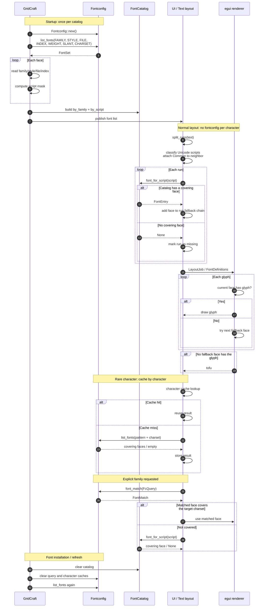
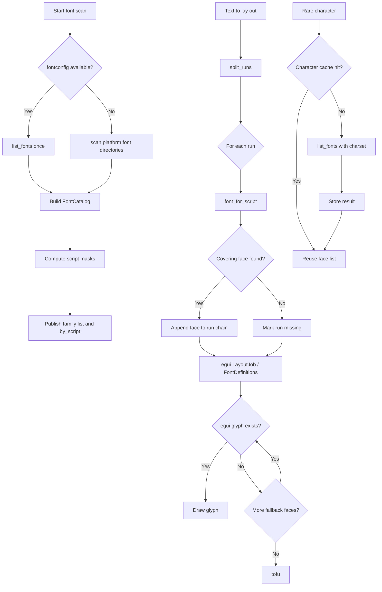

# Font discovery, fallback, and script routing for Linux

Status: design note and implementation map.

- Repository: `storytold/gridcraft`
- Branch: `fix/linux-fontconfig`
- Local HEAD: `09b0d1d perf(ui): reuse bound font data across rebinds (#1231)`
- Related issue: `#1231`

This document has three layers:

1. **Implemented** — what the code does today.
2. **Target** — the proposed font-catalog and script-run architecture.
3. **Not implemented** — known gaps, API limitations, and migration work.

Do not read a "Target" section as current behavior.

---

## 1. Purpose and scope

GridCraft must:

- show every installed font in the font picker;
- render workbook text in the chosen font;
- render CJK, Thai, Hebrew, symbols, and emoji without tofu;
- work on native Linux, Flatpak, macOS, Windows, and wasm;
- never panic because a font file is damaged or a family is not bound;
- avoid rescanning the filesystem or spawning fontconfig processes on every frame.

This document describes how fonts are discovered, matched, bound to egui, and
selected per script. It also records the exact `fontconfig` 0.11 API gaps that
must be closed, or worked around, before the target architecture can be built.

---

## 2. Executive summary

Current Linux implementation:

- `fc-list -f '%{file}\n'` discovers font files.
- Each file's SFNT/TTC table directory and `name` table are read without loading
  the whole font.
- The resulting `Face` catalog is cached in a process-wide `OnceLock`.
- `fc-match` resolves role families and script families.
- `fc-match` results are cached in a thread-local `HashMap`.
- Selected workbook fonts are bound into egui lazily; binding still reads the
  whole font file.
- Font roles are published to `cell_family()` only after egui has activated the
  new font set. This avoids a frame that names a family egui does not have yet.

Target implementation:

- Fontconfig is called once at startup to build an in-memory `FontCatalog`.
- The catalog records, per face, which Unicode scripts it covers.
- Normal text layout splits text into script runs and selects a covering face
  from memory.
- egui performs per-glyph fallback inside each run.
- Rare characters are looked up by character, cached, and then reused.
- No per-frame fontconfig calls and no per-character `font_match`.

Main unresolved issue:

- First use of a large, previously unbound family can still freeze the UI for
  roughly 1–2 seconds because egui rebuilds its font atlas and glyph cache. That
  is separate from font discovery; see §10.

---

## 3. Glossary

| Term | Meaning |
|---|---|
| Face | One font face inside a file. A TTC may contain several faces. |
| Family | Typographic family name, e.g. `Noto Sans CJK SC`. |
| Role | GridCraft's internal font slot: `ui`, `ui-bold`, `cell`, `cell-bold`, `cell-italic`, `cell-bold-italic`, `serif`, `mono`. |
| Script | Unicode script class: Latin, Han, Japanese, Korean, Thai, Hebrew, Symbols, Common. |
| Run | A contiguous span of text with the same script class. |
| Fallback | A font used when the primary font has no glyph for a character. |
| Catalog | In-memory list of installed faces with family, style, weight, italic, path, index, and script coverage. |
| Coverage | Whether a face has glyphs for all sample characters of a script run. |
| `font_match` | Fontconfig best-match operation. It always returns a closest match, even if the font does not cover the requested charset. |
| `list_fonts` | Fontconfig filtered enumeration. With a charset pattern it returns only candidates matching that pattern. |

---

## 4. Problem statement

### 4.1 egui has no font discovery

egui/eframe does not enumerate system fonts. It only knows the font data given to
`Context::set_fonts`. A `FontFamily::Name` that was never bound is not a valid
fallback; using it can panic or produce no text.

GridCraft therefore has to do both jobs:

1. discover installed families and faces;
2. bind the files a workbook actually uses into `egui::FontDefinitions`.

### 4.2 Hard-coded font paths are not portable

Different distributions put fonts in different directories:

- Debian/Ubuntu: `/usr/share/fonts/truetype/...`
- Fedora: `/usr/share/fonts/google-noto-sans-cjk-fonts/...`
- Arch: `/usr/share/fonts/noto-cjk/...`
- Flatpak: host fonts appear under `/run/host/fonts/...`
- ChromeOS Crostini: `/usr/share/fonts/chromeos/...`

A fixed list of paths will miss at least one of them. This was the original
Flatpak CJK tofu bug: the sandbox had no CJK font at any path in the hard-coded
list, even though fontconfig could see `/run/host/fonts`.

### 4.3 Fontconfig configuration differs between host and Flatpak

The host and the Flatpak sandbox do not have identical fontconfig configurations:

- host fontconfig 2.17.0; sandbox 2.17.1;
- `/etc/fonts/fonts.conf` differs in size and hash;
- the sandbox adds `05-flatpak-fontpath.conf` and `50-flatpak.conf` for
  `/run/host/fonts`, `/run/host/local-fonts`, and `/run/host/user-fonts`;
- Fedora's font-package alias files are not all mounted inside the sandbox.

Observed differences:

| Query | Host | Flatpak sandbox |
|---|---|---|
| `serif` | Noto Serif CJK SC | Noto Sans CJK SC |
| `monospace` | Noto Sans Mono CJK SC | Noto Sans CJK SC |
| `sans-serif:lang=th` | Noto Sans Thai | FreeSerif |
| `sans-serif:lang=he` | Noto Sans Hebrew | DejaVu Sans |

Consequence: do not rely on generic `serif`/`monospace` results alone. Use an
explicit family when possible, and validate coverage with a charset query.

### 4.4 `font_match` is not a coverage query

`fc-match`/`Fontconfig::font_match` means "closest match", not "font that covers
these characters". If no font covers the requested script, fontconfig still
returns a substitute. That substitute may parse and render, but produce tofu.

Use one of:

- `list_fonts` with a charset pattern and treat the result as a coverage set;
- `Pattern::sort_fonts(UnicodeCoverage::Trim)` plus explicit verification;
- after exposing the missing APIs, `Pattern::charset()` + `CharSet::has_char`.

---

## 5. Current implementation

This section describes HEAD `09b0d1d`.

### 5.1 Startup and scan

Entry point:

- `crates/ui-egui/src/lib.rs:348` `setup_context_for_language()`
- `crates/ui-egui/src/lib.rs:349` `fonts::start_scan()`

`start_scan()` (`crates/ui-egui/src/fonts.rs:460`) starts a named background
thread (`font-scan`) once. The thread calls `catalog()`.

`catalog()` (`crates/ui-egui/src/fonts.rs:449`) is a `OnceLock<Vec<Face>>`.
It blocks only the first caller; the background thread normally does that work.

`scan_installed()` (`crates/ui-egui/src/fonts.rs:432`):

1. On Linux, call `fontconfig_files()`.
2. If it returns files, scan them with `scan_files()`.
3. If the result is non-empty, use it.
4. Otherwise fall back to `scan_dirs(system_font_dirs())`.

`fontconfig_files()` (`crates/ui-egui/src/fonts.rs:399`) runs:

```text
fc-list -f "%{file}\n"
```

It parses bytes, strips `\r`, filters existing files with supported extensions
(`ttf`, `otf`, `ttc`, `otc`), and deduplicates paths. It does not assume UTF-8.

`scan_dirs()` (`crates/ui-egui/src/fonts.rs:373`) recursively walks platform
font folders, canonicalizes directories to avoid symlink loops, and calls
`scan_file()` for each candidate.

### 5.2 Metadata-only face scanning

`scan_file()` (`crates/ui-egui/src/fonts.rs:347`) does **not** read the whole
font. It calls `file_faces()` (`:331`), which calls `faces_in()` (`:298`).

`faces_in()`:

- reads the 12-byte SFNT/TTC header;
- detects `ttcf` and iterates TTC face offsets;
- for each face, calls `face_names()`;
- `face_names()` validates the SFNT version, reads the table directory, finds the
  `name` table, and calls `read_name_table()`;
- `read_name_table()` reads the name records and string storage;
- `select_name()` prefers Windows Unicode English, then other Windows Unicode,
  then Unicode, Macintosh, and finally any remaining record;
- name IDs `16`/`1` are family; `17`/`2` are style.

Bounds:

- `MAX_TTC_FACES = 1024`
- `MAX_TABLE_RECORDS = 4096`
- `MAX_NAME_RECORDS = 4096`
- `MAX_NAME_BYTES = 8192`

All offsets and lengths use checked arithmetic. A damaged file yields no faces,
not a panic.

There is no file-size limit for the metadata scan. The old 64 MiB
`MAX_FONT_FILE` limit was removed because metadata reads are bounded and huge
CJK fonts are legitimate.

### 5.3 Face catalog and family list

`Face` (`crates/ui-egui/src/fonts.rs:47`) contains:

```rust
pub struct Face {
    pub family: String,
    pub path: PathBuf,
    pub index: u32,
    pub weight: f32,
    pub italic: bool,
}
```

Style names are converted to weight and italic flags by `style_weight()` and
`style_italic()`.

`families()` (`:507`) builds the font picker list:

- standard `ribbon::FONTS` names first;
- then installed family names, A–Z, case-insensitively deduplicated.

It never blocks: if the scan is not done, it returns only the standard names.

### 5.4 Font roles and `fc-match`

`theme.rs:251 candidates(role)` produces candidate `(path, index)` pairs.

On Linux, fontconfig candidates are added first:

```rust
#[cfg(target_os = "linux")]
v.extend(linux_fontconfig_candidates(role));
```

The remaining hard-coded paths are a fallback for systems where fontconfig is
missing or returns nothing usable.

`linux_fontconfig_candidates()` (`theme.rs:369`) maps roles to patterns:

| Role | Patterns, in order |
|---|---|
| `ui` | Cantarell, Liberation Sans, DejaVu Sans, Noto Sans, sans-serif |
| `ui-bold` | same with `:weight=bold` |
| `cell` | Calibri, Carlito, Arial, Liberation Sans, DejaVu Sans, sans-serif |
| `cell-bold` | same with `:weight=bold` |
| `cell-italic` | same with `:slant=italic` |
| `cell-bold-italic` | same with `:weight=bold:slant=italic` |
| `serif` | Liberation Serif, DejaVu Serif, serif |
| `mono` | Liberation Mono, DejaVu Sans Mono, Noto Sans Mono, monospace |

`fc_match_candidates()` (`theme.rs:396`) calls `fc_match()` for each pattern,
drops duplicate `(path, index)` pairs, and returns the candidates.

`fc_match()` (`theme.rs:617`) first checks the thread-local `FC_MATCH_CACHE`.
On a miss it runs:

```text
fc-match -f "%{file}\n%{index}\n" <pattern>
```

Results, including failures, are cached for the rest of the process. There is no
invalidation: fonts installed while GridCraft is running are picked up only after
restart.

The fontconfig `index` is masked with `& 0xFFFF`. Fontconfig stores a named
instance in the high 16 bits and the face index in the low 16 bits. egui's
`FontData::index` is a face index, not a named-instance selector.

### 5.5 Font definitions

`font_definitions_with_bound()` (`theme.rs:448`) builds the egui font set and
returns `(FontDefinitions, Vec<String>)`.

It:

1. starts from egui's defaults;
2. loads script fallback faces via `load_fallback()`;
3. for each role (`ui`, `ui-bold`, `cell`, `cell-bold`, `cell-italic`,
   `cell-bold-italic`, `serif`, `mono`):
   - resolves candidates;
   - loads the first parseable face with `try_load()`;
   - inserts it as `sys-{role}`;
   - falls back to `sys-ui` or `sys-cell` for missing bold/italic roles;
   - extends the chain with egui's base proportional/monospace chain and the
     script fallback keys;
4. binds installed workbook families with `bind_family()`;
5. inserts the cell face before script fallback faces in interface chains;
6. sets `FontFamily::Proportional` to the UI chain;
7. drops unparseable faces with `drop_unparseable_fonts()`.

`font_definitions_with()` (`theme.rs:439`) is the non-deferred wrapper: it calls
`font_definitions_with_bound()` and immediately publishes `set_bound(bound)`.

`font_definitions_with_bound()` is used when egui will activate the new set on
the next pass. Publishing the roles immediately would let `cell_family()` name a
family that the current pass has not installed yet.

### 5.6 Script fallback

`fallback_faces()` (`theme.rs:541`) returns, in chain order:

1. `sys-cjk-han-zh` or `sys-cjk-han-ja` depending on `HanOrder`
2. the other Han face
3. `sys-cjk-hangul`
4. `sys-thai`
5. `sys-hebrew`
6. `sys-symbols`
7. `sys-symbols-2`

Each script function adds fontconfig candidates first on Linux:

- Japanese: `sans-serif:lang=ja`, `serif:lang=ja`
- Simplified Chinese: `sans-serif:lang=zh-cn`, `serif:lang=zh-cn`
- Korean: `sans-serif:lang=ko`, `serif:lang=ko`
- Thai: `sans-serif:lang=th`
- Hebrew: `sans-serif:lang=he`
- Symbols: DejaVu Sans, Symbola, Noto Sans Symbols 2, Noto Sans Symbols
- Symbols 2: Noto Sans Symbols 2, Symbola, Noto Sans Symbols

Then it appends the hard-coded paths in `LINUX_CJK_FALLBACK_DIRS`
(`theme.rs:564`) and the platform-specific paths.

`load_fallback()` (`theme.rs:509`) loads at most one file per script key and
records loaded paths. It currently deduplicates by **path only** and uses
`break` when a path is already loaded. That is correct for a region-merged TTC
that covers several scripts, but wrong when the same TTC contains different
faces for different scripts: the later script never tries another face. This is
a known issue.

### 5.7 Binding workbook fonts

`used_fonts()` (`lib.rs:356`) collects the families the workbook actually uses:

- cell styles;
- theme heading/body fonts;
- shape text fonts.

`installed_among()` (`fonts.rs:488`) filters that list against the catalog,
sorts it, and deduplicates it.

For each installed family, `bind_family()` calls `bind_faces()`.

`bind_faces()` (`fonts.rs:557`):

- returns no roles for an empty face list;
- for each `(bold, italic)` combination, calls `pick_face()`;
- chains the primary face with the family's regular face;
- reads the whole file with `std::fs::read()` if the key is not already present;
- inserts `FontData` with the face index;
- extends the chain with egui's base proportional chain;
- inserts a `FontFamily::Name("fnt:{family}:{b|n}{i|n}")`;
- returns the bound role keys.

`pick_face()` (`fonts.rs:529`) falls back to the regular face when an exact
bold/italic face is missing. That means an italic role can be bound to a regular
face; the italic button may then appear to do nothing for fonts without an
italic face. This is a known limitation.

`bind_faces()` avoids duplicate reads by checking
`fonts.font_data.contains_key(&key)` before `std::fs::read()`.

### 5.8 Rebind and flicker avoidance

`lib.rs` fields:

- `fonts_rebind: bool`
- `pending_bound: Option<Vec<String>>`

Flow (`lib.rs:1042`–`1079`):

1. If `!fonts_ready`, rebuild the base font set, clear `pending_bound`, and wait
   for the next pass.
2. Else if `fonts_rebind`, egui has activated the set made on the previous pass:
   publish `pending_bound` with `fonts::set_bound()`, clear the flag.
3. Else if the scan is done and the workbook revision changed, compute
   `used_fonts()`. If it differs from `fonts_bound`, build with
   `font_definitions_with_bound()`, call `ctx.set_fonts()`, store
   `pending_bound`, set `fonts_rebind`, and request a repaint.

The UI no longer returns early solely because `fonts_rebind` is true. This
removed the one-frame blank flash. First use of a large unbound family still
costs the actual font-atlas rebuild.

### 5.9 Current limitations

| Limitation | Effect |
|---|---|
| `fc-match` for every role pattern | 52 subprocess calls on a cold rebuild; cached afterwards. |
| `list_fonts`/`fc-list` subprocess | No direct fontconfig library access; extra process and parsing. |
| First bind reads whole font | Large CJK font can read 56 MiB; cold page cache can take seconds. |
| `pending_bound` solves flash, not atlas cost | First frame after a large new font can still freeze. |
| `load_fallback` dedupes by path only | Same TTC with different faces for different scripts is not fully used. |
| `try_load` checks parseability, not script coverage | `fc-match` substitute may be chosen even if it lacks the script. |
| `families()` rebuilds the list on every call | Ribbon calls it per frame; potentially wasteful. |
| Missing italic face binds regular | Italic button may look ineffective for fonts without an italic face. |
| No cache invalidation | Fonts installed while running are not picked up until restart. |
| Host/Flatpak fontconfig differs | Generic `serif`/`monospace`/Thai/Hebrew results can differ. |

---

## 6. Target architecture

### 6.1 Data model

```rust
#[derive(Clone, Copy, Debug, PartialEq, Eq)]
pub enum ScriptClass {
    Latin,
    Han,
    Japanese,
    Korean,
    Thai,
    Hebrew,
    Symbols,
    Common,
}

#[derive(Clone, Copy, Debug, Default)]
pub struct ScriptMask(u16);

#[derive(Clone, Debug)]
pub struct FontEntry {
    pub family: String,
    pub style: String,
    pub path: PathBuf,
    pub index: u32,
    pub weight: f32,
    pub italic: bool,
    pub scripts: ScriptMask,
}

pub struct FontCatalog {
    pub fonts: Vec<FontEntry>,
    pub by_family: HashMap<String, Vec<usize>>,
    pub by_script: HashMap<ScriptClass, Vec<usize>>,
}
```

Rules:

- `FontEntry` owns only plain data; it is `Send` and can live in a shared
  catalog.
- Do not store `fontconfig::Pattern`, `CharSet`, or `FontSet` in the catalog;
  they are `!Send`/`!Sync`.
- `by_script` is sorted by preference, not by fontconfig order alone.

### 6.2 Startup

1. Create one `Fontconfig` handle per worker thread that needs it.
2. Call `list_fonts` once with `ObjectSet` including:
   - `FC_FAMILY`
   - `FC_STYLE`
   - `FC_FILE`
   - `FC_INDEX`
   - `FC_WEIGHT`
   - `FC_SLANT`
   - `FC_CHARSET` (if the wrapper can read it)
3. Convert each result to `FontEntry`.
4. Compute `scripts`:
   - preferred: `Pattern::charset()` + `CharSet::has_char()` on sample chars;
   - fallback: `list_fonts` with a charset pattern per script, then record
     `(path, index)` membership.
5. Build `by_family` and `by_script`.
6. Publish the catalog to the UI.

Sample characters per script:

| Script | Samples |
|---|---|
| Latin | `A`, `é`, `ß` |
| Han | `中`, `汉`, `字` |
| Japanese | `あ`, `日`, `本` |
| Korean | `한`, `글` |
| Thai | `ก`, `ข` |
| Hebrew | `א`, `ב` |
| Symbols | `✓`, `★`, `→` |

### 6.3 Text layout

Do not query fontconfig per character.

1. `split_runs(text)` classifies each `char`.
2. `Common` characters attach to the previous run; if there is no previous run,
   attach to the next run; if the whole text is Common, classify as Latin.
3. For each run, `font_for_script(script)` returns the best `FontEntry`.
4. Add that face to the run's fallback chain.
5. Hand the runs to egui:
   - Option A: append the script face to the global fallback chain;
   - Option B: use `LayoutJob` + `FontFamily::Name` for exact per-run families.

Start with A. Use B only when a single global chain cannot express the desired
mixing.

### 6.4 Rare characters

For characters not covered by the selected run font:

1. Check a character cache.
2. On a miss, query `list_fonts` with the character's charset.
3. Store the covering `(path, index)` list, including an empty result.
4. Choose from the result, or tofu if empty.

Do not put a non-covering `font_match` result into the fallback chain.

### 6.5 Refresh

When fonts are installed or removed:

1. clear the catalog;
2. clear role and script caches;
3. re-run `list_fonts`;
4. rebuild egui font definitions if the current workbook uses affected families.

---

## 7. Target sequence diagram



---

## 8. Target flowchart



---

## 9. Algorithm notes

### 9.1 `classify`

Use Unicode scalar ranges, not locale:

- Han: CJK Unified Ideographs and extensions, CJK compatibility ideographs.
- Japanese: Hiragana and Katakana.
- Korean: Hangul syllables and Jamo.
- Thai: Thai block.
- Hebrew: Hebrew block.
- Symbols: arrows, geometric shapes, dingbats, technical symbols, emoji.
- Common: ASCII punctuation, digits, whitespace, combining marks.

Digits and punctuation are intentionally `Common` so they do not force a font
switch inside a word.

### 9.2 `split_runs`

```text
last = Latin
for each char:
    c = classify(char)
    if c == Common:
        keep current run
    elif c == last:
        append to current run
    else:
        start a new run
last = c
```

If the entire string is Common, return one Latin run.

### 9.3 `font_for_script`

Return the first `FontEntry` in `by_script[script]` that:

- has a file;
- still parses;
- is not already the primary face of the run;
- has the best family preference for the current UI language.

Han preference follows `HanOrder`: Chinese first for non-Japanese UI, Japanese
first for Japanese UI.

### 9.4 Coverage

Do not trust `font_match` alone.

Preferred:

```text
matched = font_match(query)
if matched.charset().has_char(sample):
    use matched
else:
    use catalog.font_for_script(script)
```

Fallback if `charset()`/`has_char()` are unavailable:

```text
coverage = list_fonts(pattern + charset)
if (matched.path, matched.index) in coverage:
    use matched
else:
    use catalog.font_for_script(script)
```

The fallback requires one `list_fonts` per script at startup, not per character.

---

## 10. Performance

### 10.1 Metadata scan benchmark

Measured on the development host with 237 supported font files and 287 faces:

| Method | Bytes read per round | Median |
|---|---:|---:|
| Whole-file `std::fs::read` + skrifa | 399,300,284 (~380.8 MiB) | 127.7–142.3 ms |
| Metadata-only table/name read | a few KiB per face | 4.6–4.7 ms |

Speedup: roughly 27–30×. Both methods produced 287 faces.

The benchmark was temporary and is not in the current worktree. Re-add it as an
ignored test if the scanner changes.

### 10.2 Rebind timing

Before caching and read deduplication:

- 52 `fc-match` calls: roughly 924–1339 ms;
- one large face read four times:
  - `Noto Serif CJK SC`: 5838.6 ms cold / 4 reads / 224,565 KiB;
  - warm: 249.4 ms;
- `font_definitions_with_bound`: 888–1610 ms;
- first frame: 194–531 ms; cold worst case 22 s.

After caching and deduplication:

- cold first build: 1152.4 ms (52 `fc-match` calls: 1122.7 ms);
- warm builds: 26.8 ms and 19.5 ms; `fc-match` calls: 0.0 ms;
- `Droid Sans Thai`: 1 read / 34 KiB / 9.5 ms;
- `Noto Serif CJK SC`: 1 read / 56,141 KiB / 5398.4 ms cold;
- first frame still showed `+11571.5 ms` and `+43093.9 ms` on cold runs;
- manual warm tests: build 9–71 ms, first frame 110–420 ms.

Interpretation:

- Fontconfig process calls are solved by the cache.
- Repeated file reads are solved by the `font_data` key check.
- Cold large-font read is still I/O-bound; the OS page cache decides the cost.
- The remaining 1–2 s freeze is dominated by egui font-atlas and glyph-cache
  rebuild, not by `fc-match` or metadata scanning.

### 10.3 What not to cache

- Do not cache `fontconfig::Pattern` or `CharSet`: `!Send`/`!Sync`.
- Do not cache `FontSet` across threads.
- Cache plain `(path, index)` and owned metadata.
- Cache negative lookups too; otherwise a missing family is retried on every
  rebuild.

---

## 11. Failure modes and invariants

| Failure | Required behavior |
|---|---|
| `fc-list` missing | Fall back to `system_font_dirs()` and `scan_dirs()`. |
| `fc-match` missing | Use hard-coded role candidates. |
| Damaged font file | Skip it; never panic. |
| TTC index out of range | Skip that face. |
| Huge font file | Metadata read is bounded; full read only when binding. |
| No CJK font | Keep Latin; CJK characters render tofu, not crash. |
| Font lacks italic face | Do not bind an italic role to regular unless explicitly intended. |
| Same TTC, different script faces | Deduplicate by `(path, index)`, not path only. |
| Generic `serif` in Flatpak | Do not assume host result; use explicit family or charset query. |
| Font installed while running | Not visible until restart unless refresh is implemented. |
| egui family not bound | Never name it from `cell_family()`. |
| wasm | No system fonts; return standard list only. |

Invariants:

1. `cell_family()` only returns an egui family that has data.
2. `FontData::index` is a face index, never a named-instance encoding.
3. A failed font parse costs one fallback, never a panic.
4. The UI thread never scans font directories.
5. Normal layout never spawns `fc-match` per character.

---

## 12. Tests

Current relevant tests:

- `crates/ui-egui/src/fonts.rs`:
  - `style_names_map_to_weight_and_slant`
  - `role_keys_are_stable_and_distinct`
  - metadata/TTC tests
  - `fontconfig_files_are_existing_supported_fonts`
  - `scan_files_catalogs_supported_fonts_once`
- `crates/ui-egui/src/theme.rs`:
  - `fallback_faces_are_appended_to_every_family`
  - `fallback_faces_load_each_file_once`
  - `fallback_covers_its_script`
  - `fontconfig_candidates_are_ordered_and_deduplicated`
  - `fontconfig_serif_match_precedes_hard_coded_paths`
  - `chromeos_font_layout_is_probed`

CI without CJK:

- Do not assert that a CJK glyph renders on a machine without a CJK font.
- Gate script coverage assertions on `fc-list :lang=<lang>` returning a
  non-empty result on Linux.
- On non-Linux, keep the path-existence test instead of skipping everything.
- Use synthetic fonts in tests when the property under test is parser behavior,
  not system font availability.

Current test result:

```text
cargo +1.95.0 test -p gridcraft-ui-egui --lib
106 passed, 0 failed
```

Full `cargo xtask ci` is currently blocked by a pre-existing unrelated clippy
error in `crates/xlsx/src/xls/mod.rs:273`
(`clippy::collapsible_match`).

---

## 13. fontconfig 0.11 API coverage and gaps

Crate facts:

- `fontconfig` 0.11.0, MIT.
- Depends on `yeslogic-fontconfig-sys ^6.0.0`.
- The `dlopen` feature loads fontconfig at runtime.
- `Pattern` and `CharSet` are `!Send` and `!Sync`.
- `GridCraft` has `unsafe_code = "forbid"` in `Cargo.toml:59`; do not add raw
  FFI inside GridCraft.

### 13.1 Available in 0.11

| Need | API |
|---|---|
| Initialize | `Fontconfig::new()` |
| Enumerate fonts | `fontconfig::list_fonts(&Pattern, Some(&ObjectSet))` |
| Best match | `Pattern::font_match()` |
| Sorted fallback | `Pattern::sort_fonts(UnicodeCoverage::Trim)` |
| Add string/integer | `Pattern::add_string`, `add_integer` |
| Add charset filter | `Pattern::add_charset(CharSet)` |
| Add one char | `CharSet::add_char(char)` |
| Read family/style | `Pattern::get_string(FC_FAMILY / FC_STYLE)` |
| Read file/index | `Pattern::filename`, `Pattern::face_index` |
| Read weight/slant/width | `Pattern::weight`, `slant`, `width` |
| Read language set | `Pattern::lang_set` |
| Raw pointer if needed | `Pattern::as_ptr`, `as_mut_ptr` |

Semantics:

- `font_match()` always returns a closest match, even when the charset is not
  covered.
- `list_fonts()` filters by the pattern. With a charset pattern it returns
  candidates covering that charset.
- `list_fonts("sans-serif")` does not resolve generic aliases. Resolve with
  `font_match()` first, or use a concrete family.

### 13.2 Missing but needed for direct charset introspection

| Need | Missing Rust API | C API |
|---|---|---|
| Does this charset contain a char? | `CharSet::has_char(char) -> bool` | `FcCharSetHasChar` |
| Get a font pattern's charset | `Pattern::charset() -> Result<Option<CharSet>, _>` | `FcPatternGetCharSet` |
| Count chars (optional) | `CharSet::count() -> u32` | `FcCharSetCount` |
| Union/intersect (optional) | `CharSet::union`, `intersect` | `FcCharSetUnion`, `FcCharSetIntersect` |
| Raw charset pointer (only for external extension) | `CharSet::as_ptr()` | none |

C signatures:

```c
FcBool FcCharSetHasChar(const FcCharSet *fcs, FcChar32 ucs4);

FcResult FcPatternGetCharSet(
    const FcPattern *p,
    const char *object,
    int n,
    FcCharSet **c
);

FcCharSet *FcCharSetDuplicate(const FcCharSet *fcs);
```

Implementation notes if adding upstream:

- `Pattern::charset()` must duplicate the borrowed `FcCharSet` before returning
  an owned `CharSet`; otherwise the pattern may free it first.
- Return `None` when the pattern has no charset, not an error.
- `CharSet::has_char` is a cheap wrapper over `FcCharSetHasChar`.
- `CharSet` must continue to destroy its `FcCharSet` in `Drop`.
- All wrappers must remain `!Send`/`!Sync`; do not put them in global state.

### 13.3 Workaround without new APIs

Build coverage sets at startup:

```text
for each script:
    charset = CharSet::new()
    for sample in script_samples:
        charset.add_char(sample)
    pattern = Pattern::new()
    pattern.add_charset(charset)
    fonts = list_fonts(pattern, objects)
    coverage[script] = { (filename, face_index) for each font }
```

Then:

```text
matched = font_match(query)
if (matched.filename, matched.face_index) in coverage[script]:
    use matched
else:
    use first catalog face in coverage[script]
```

This avoids both missing APIs. The cost is a few extra `list_fonts` calls at
startup, not per character.

### 13.4 Recommendation

Short term:

- keep `fc-list` / `fc-match` subprocesses;
- keep the thread-local `FC_MATCH_CACHE`;
- add coverage sets only when implementing script routing.

Medium term:

- open an upstream `fontconfig-rs` PR for `CharSet::has_char` and
  `Pattern::charset`;
- switch GridCraft to the safe `fontconfig` crate with `dlopen`;
- keep the subprocess path as a fallback for systems without the library.

Do not add `yeslogic-fontconfig-sys` directly to GridCraft: raw FFI violates
the repository's `unsafe_code = "forbid"` policy.

---

## 14. Migration plan

### Phase 1: preserve current behavior

- Keep `fc-list` discovery and metadata scan.
- Keep `fc-match` role candidates.
- Keep hard-coded fallbacks.
- Keep `pending_bound`.
- Add tests for TTC faces, malformed tables, and no-fontconfig fallback.

### Phase 2: build the catalog

- Introduce `FontEntry` and `FontCatalog`.
- Build script coverage sets with `list_fonts` + charset.
- Keep the existing `Vec<Face>` as a compatibility view.
- Add a feature flag or internal switch so the old path remains testable.

### Phase 3: script routing

- Add `classify` and `split_runs`.
- Add `font_for_script`.
- Start with global fallback chains; add `LayoutJob` per-run only if needed.
- Add synthetic tests for mixed-script text.

### Phase 4: replace subprocesses

- Add `fontconfig` 0.11 as a Linux target dependency with `dlopen`.
- Replace `fc-list` with `list_fonts`.
- Replace `fc-match` with `font_match`.
- Keep process fallback if library loading fails.
- Do not store `Pattern`/`CharSet` in shared state.

### Phase 5: refresh and performance

- Add explicit refresh after font installation.
- Cache family lists after the scan.
- Measure first-frame cost with large CJK fonts.
- Decide whether the atlas rebuild can be made incremental or off-thread.

---

## 15. Current project status

- Branch: `fix/linux-fontconfig`
- HEAD: `09b0d1d`
- Remote PR branch: `fork/fix/linux-fontconfig` at old head `6531ce0`
- PR: `#1972`
- PR state: open, conflicting with `main`
- Local worktree: only `docs/font-flow.md` untracked
- Not pushed after the local commits

Commits on the branch (newest first):

```text
09b0d1d perf(ui): reuse bound font data across rebinds (#1231)
8eb6977 perf(ui): cache Linux fontconfig lookups (#1231)
fb96434 fix(ui): defer bound font roles until fonts activate (#1231)
b282d8f fix(ui): list installed Linux fonts in the ribbon (#1231)
2ed8fc0 fix(ui): resolve Linux font roles with fontconfig (#1231)
a80b10c perf(ui): read font names without loading whole files (#1231)
4d9068a fix(ui): discover Linux fonts with fontconfig (#1231)
c17854d fix(ui): start Linux font scan on context setup (#1231)
```

Current app behavior:

- Chinese UI and cell text render correctly on the host.
- Format Cells font list includes host fonts.
- Ribbon font list includes host fonts.
- First use of a large unbound CJK family can still freeze for 1–2 seconds.
- Italic is ineffective for families without an italic face.

---

## 16. Open questions

1. Should the catalog store `script_mask` only, or also a coarse
   `coverage: Vec<(u32, u32)>` range list? The latter enables exact rare-character
   checks without fontconfig.
2. Should `split_runs` attach Common punctuation to the previous run, the next
   run, or duplicate it into both? Previous is simpler and usually correct.
3. Should script routing use one global fallback chain (Option A) or per-run
   `LayoutJob` families (Option B)? Start with A and measure.
4. Can egui's atlas rebuild be moved off the UI thread, or made incremental for
   newly added faces?
5. Should the catalog refresh automatically on font installation, or only on
   restart?
6. Should GridCraft bundle a minimal CJK fallback for Flatpak? This conflicts
   with the current "no bundled fonts by default" policy and the
   `storytold/craft-fonts` rule.
7. Should `fontconfig` 0.11 be a direct dependency, or should GridCraft keep the
   subprocess path and only use the library when available?
8. How should `fc-match` differences between host and Flatpak be tested in CI?

---

## 17. File and command reference

### Source files

| Path | Responsibility |
|---|---|
| `crates/ui-egui/src/fonts.rs` | Discovery, metadata scan, catalog, family list, binding. |
| `crates/ui-egui/src/theme.rs` | Role candidates, `fc-match`, fallback faces, `FontDefinitions`. |
| `crates/ui-egui/src/lib.rs` | Startup, background scan, rebind state, `pending_bound`. |
| `crates/ui-egui/src/ribbon.rs` | Ribbon font combo, `FONTS` standard list. |
| `crates/ui-egui/src/dialogs.rs` | Format Cells font list. |
| `Cargo.toml` | `unsafe_code = "forbid"` at line 59. |

### Commands

```bash
# Format
cargo +1.95.0 fmt --all

# Check
cargo +1.95.0 check -p gridcraft-ui-egui

# Tests
cargo +1.95.0 test -p gridcraft-ui-egui --lib

# Clippy
cargo +1.95.0 clippy -p gridcraft-ui-egui --all-targets --no-deps -- -D warnings

# Run locally with control channel
RUST_LOG='warn,gridcraft*=info' cargo +1.95.0 run -p gridcraft -- \
  --sample sales --control 7979

# Inspect fontconfig in the Flatpak
flatpak run --command=sh ai.storyteller.gridcraft//fontfix -c \
  'fc-list -f "%{file}\n" | wc -l'

# Inspect a specific match
fc-match -f '%{file}\t%{index}\t%{family}\n' 'sans-serif:lang=zh-cn'
```

### Test chat control

```json
{"id":1,"method":"engine.execute","params":{"command":"home.fontName","params":{"name":"Noto Serif CJK SC"}}}
{"id":2,"method":"ui.screenshot","params":{"path":"/tmp/opencode/font.png"}}
```

---

## 18. Appendix: host vs Flatpak observations

Measured on the development host:

```text
sans-serif                  Noto Sans CJK SC        index 2
serif                       Noto Serif CJK SC       index 196610 -> face 2
monospace                   Noto Sans Mono CJK SC   index 7
Calibri                     Carlito                 index 0
Times New Roman             Liberation Serif        index 0
sans-serif:lang=zh-cn       Noto Sans CJK SC        index 2
sans-serif:lang=ja          Noto Sans CJK JP        index 0
sans-serif:lang=ko          Noto Sans CJK KR        index 1
sans-serif:lang=th          Noto Sans Thai          index 0
sans-serif:lang=he          Noto Sans Hebrew        index 0
```

Measured in the Flatpak sandbox:

```text
sans-serif                  /run/host/fonts/.../NotoSansCJK-Regular.ttc  index 2
serif                       Noto Sans CJK SC        index 2
monospace                   Noto Sans CJK SC        index 2
Calibri                     Carlito                 index 0
Times New Roman             Liberation Serif        index 0
sans-serif:lang=zh-cn       Noto Sans CJK SC        index 2
sans-serif:lang=ja          Noto Sans CJK JP        index 0
sans-serif:lang=ko          Noto Sans CJK KR        index 1
sans-serif:lang=th          FreeSerif               index 0
sans-serif:lang=he          DejaVu Sans             index 0
```

The important difference is not just the path (`/usr/share/fonts` vs
`/run/host/fonts`), but the alias configuration: generic `serif`, `monospace`,
Thai, and Hebrew can resolve differently inside the sandbox.
